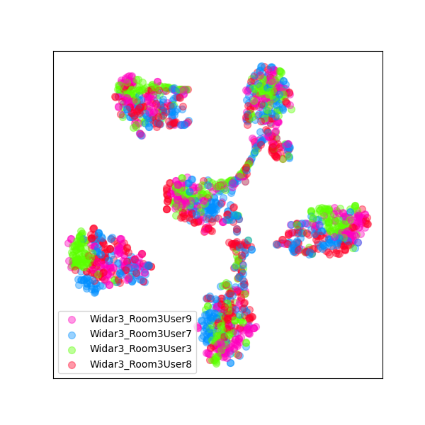
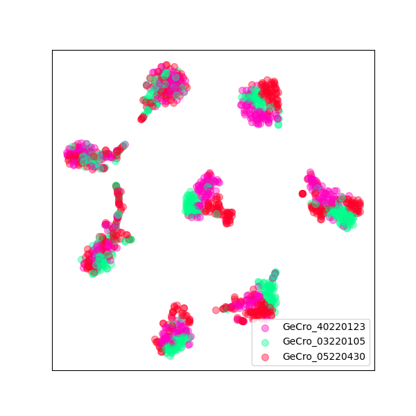
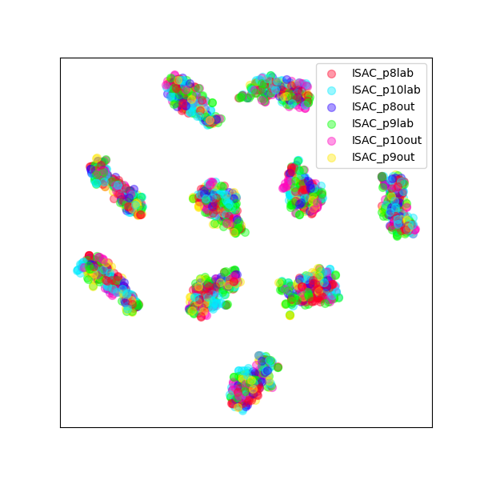

# TransWi

**A Local-aware Transformer with Window and Dual Attention for Efficient Wireless-based Human Activity Recognition**

📄 **Paper:** Accepted by *IEEE Transactions on Mobile Computing (TMC)*

## News

- **[2026-11]** 🎉 Our paper, "A Local-aware Transformer with Window and Dual Attention for Efficient Wireless-based Human Activity Recognition," has been accepted by **IEEE Transactions on Mobile Computing (TMC)**!
- **[2025-07-31]** The source code of TransWi has been released.

## Abstract

Wireless sensing-based human activity recognition (HAR) is a promising technology for smart home and healthcare applications. Recently, transformer-based HAR methods have attracted increasing attention because of their ability to capture long-range temporal dependencies. However, traditional transformer models are often large and computationally inefficient. In this paper, we present TransWi, a lightweight transformer architecture tailored for wireless spectrogram-based HAR. Specifically, it uses local-aware fusion to pack adjacent temporal tokens into the frequency embedding, thereby reducing temporal redundancy while preserving local motion information. Subsequently, a query-preserving window attention block is introduced to inject local 2D time-frequency priors. Then, it is followed by a dual-attention block that models both temporal and frequency dependencies. Finally, a spectrogram augmentation strategy and feature regularization are adopted to improve out-of-domain generalization within each dataset. Independent evaluations on three public datasets, Widar3.0, GeCro, and ISAC, show that TransWi achieves in-domain accuracies of 99.47\%, 97.64\%, and 98.49\%, and out-of-domain accuracies of 94.12\%, 93.35\%, and 97.73\%, respectively. On a Raspberry Pi 5, TransWi-S recognizes activities in 3.77 ms with only 10.13 MB of memory, demonstrating an effective accuracy-efficiency trade-off for edge computing.

## Visualization of Features Using t-SNE

| **Widar3.0** | **GeCro** | **ISAC** |
|-------------|-----------|----------|
|  |  |  |

## Citation

If you find TransWi useful in your research, please consider citing our paper:

```bibtex
@article{transwi2026,
  title   = {A Local-aware Transformer with Window and Dual Attention for Efficient Wireless-based Human Activity Recognition},
  author  = {Author Names},
  journal = {IEEE Transactions on Mobile Computing},
  year    = {2026},
}
```

